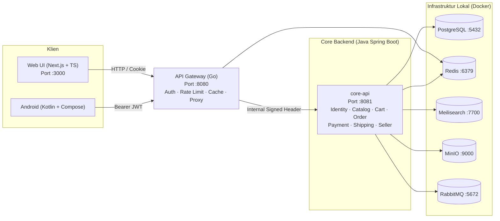

# 🏠 Griyaku — Marketplace Alat & Perlengkapan Rumah Tangga

<p align="center">
  
</p>

<p align="center">
  <strong>Platform Marketplace Modern untuk Kebutuhan Rumah Tangga Berkualitas</strong><br />
  Multi-toko · Keranjang Per-Toko · Rekening Bersama (Escrow) · Pelacakan Real-Time
</p>

<p align="center">
  
  
  
  
  
  
</p>

---

## 📖 Tentang Griyaku

**Griyaku** adalah platform e-commerce marketplace yang didedikasikan khusus untuk kebutuhan dan perlengkapan rumah tangga keluarga Indonesia. Menggabungkan estetika belanja modern bertaraf internasional dengan kemudahan transaksi lokal yang aman dan transparan.

Griyaku mempertemukan **pembeli** dengan berbagai **penjual/toko resmi (official stores & verified sellers)** alat rumah tangga, meliputi kategori:
- 🍳 **Dapur & Memasak**: Air fryer, wajan granit, rice cooker, blender, set pisau dapur, perlengkapan baking.
- 🧹 **Kebersihan & Sanitasi**: Robot vacuum cleaner, pel otomatis double drive, desinfektan, alat pembersih kaca.
- ⚡ **Elektronik Rumah Tangga**: Air purifier HEPA, setrika uap, dispenser pintar, smart lamp, kipas sirkulasi.
- 🛋️ **Perabot & Dekorasi**: Kursi santai Scandinavian, meja minimalis, rak bumbu dapur, organizer serbaguna.

### Nilai Utama & Fitur Unggulan
1. **Multi-Store & Grouped Cart**: Pembeli dapat memasukkan barang dari berbagai toko sekaligus ke satu keranjang yang rapi dikelompokkan per toko untuk efisiensi ongkos kirim.
2. **Rekening Bersama Aman (Escrow)**: Dana pembayaran pembeli ditahan aman oleh platform dan baru diteruskan ke penjual setelah barang diterima dengan baik.
3. **Visual UI Premium & Interaktif**: Menggunakan palet warna hijau alami (`#006A4E`), tipografi kontemporer, dan micro-animation GSAP yang responsif dan memanjakan mata.
4. **Seller Center Lengkap**: Manajemen etalase produk, input varian & stok, pemrosesan pesanan, input resi, dan simulasi penarikan saldo toko.

---

## 🛠️ Bahasa Pemrograman & Tools yang Digunakan

Proyek ini dibangun menggunakan arsitektur **polyglot modern** dengan pemisahan tanggung jawab yang ketat (*separation of concerns*). Ikon dan logo didukung oleh [Devicon](https://devicon.dev):

### 1. Web Frontend (`apps/web`)
| Tools & Bahasa | Logo / Ikon | Peran & Keterangan |
| :--- | :---: | :--- |
| **Next.js** |  | Framework UI berbasis React Server Components & App Router (hanya bertindak sebagai presentation layer UI). |
| **React** |  | Library pondasi komponen antarmuka yang reaktif dan interaktif. |
| **TypeScript** |  | Type safety end-to-end pada seluruh kode frontend web. |
| **Tailwind CSS** |  | Utility-first CSS dengan custom design token tema Griyaku (`#006A4E`). |

---

### 2. API Gateway & Keamanan Jaringan (`services/gateway`)
| Tools & Bahasa | Logo / Ikon | Peran & Keterangan |
| :--- | :---: | :--- |
| **Go (Golang)** |  | Bahasa pintu gerbang utama klien (BFF). Menangani verifikasi JWT (JWKS), rate limiting, CORS, caching Redis, dan proxying internal. |

---

### 3. Core Backend & Logika Bisnis (`services/core-api`)
| Tools & Bahasa | Logo / Ikon | Peran & Keterangan |
| :--- | :---: | :--- |
| **Java 21 (LTS)** |  | Sumber kebenaran domain bisnis, transaksi database, aturan diskon, dan manajemen pesanan. |
| **Spring Boot** |  | Framework enterprise modular monolith (Spring Data JPA, Security, Flyway, Modulith). |
| **Gradle** |  | Build automation tool untuk modul backend Java (Kotlin DSL). |

---

### 4. Mobile App (`apps/android`)
| Tools & Bahasa | Logo / Ikon | Peran & Keterangan |
| :--- | :---: | :--- |
| **Kotlin** |  | Bahasa utama aplikasi Android native. |
| **Android & Compose** |  | UI deklaratif modern menggunakan Jetpack Compose & Material 3. |

---

### 5. Database, Cache, Messaging & Infrastruktur
| Tools & Layanan | Logo / Ikon | Peran & Keterangan |
| :--- | :---: | :--- |
| **PostgreSQL** |  | Relational database utama untuk penyimpanan entitas pengguna, toko, produk, pesanan, dan transaksi. |
| **Redis** |  | In-memory cache cepat, rate limiter token bucket, dan session storage. |
| **RabbitMQ** |  | Message broker asynchronous untuk event outbox (pesanan dibuat, notifikasi, update stok). |
| **Docker** |  | Orkestrasi kontainer infrastruktur lokal (PostgreSQL, Redis, RabbitMQ, Meilisearch, MinIO, Mailpit). |
| **Git & GitHub** |  | Version control dan kolaborasi monorepo. |

---

## 🏛️ Arsitektur Sistem



---

## 🚀 Panduan Menjalankan Project

### 1. Prasyarat Sistem
- **Docker Desktop** (aktif)
- **Node.js** (LTS terbaru) & **pnpm** (atau npm)
- **Java JDK 21+**
- **Go** ≥ 1.24

---

### 2. Menjalankan Infrastruktur Database (Docker)
Jalankan di terminal root project:
```bash
docker compose -f infra/docker/compose.yml up -d
```
> Perintah ini akan menjalankan PostgreSQL (`5432`), Redis (`6379`), Meilisearch (`7700`), MinIO (`9000`), RabbitMQ (`5672`), dan Mailpit (`8025`).

---

### 3. Menjalankan Setiap Service (Buka Terminal Terpisah)

#### 🔹 Terminal 1: Backend Java (Spring Boot - Port 8081)
- **Windows PowerShell:**
  ```powershell
  .\gradlew.bat :services:core-api:bootRun
  ```
- **Linux / macOS:**
  ```bash
  ./gradlew :services:core-api:bootRun
  ```

#### 🔹 Terminal 2: API Gateway Go (Port 8080)
- **Windows PowerShell / CMD:**
  ```powershell
  cd services\gateway; go run ./cmd/gateway
  ```
- **Linux / macOS:**
  ```bash
  cd services/gateway && go run ./cmd/gateway
  ```

#### 🔹 Terminal 3: Web Frontend Next.js (Port 3000)
- **Semua OS:**
  ```bash
  pnpm --filter web dev
  ```
  *(Atau: `cd apps/web && pnpm dev`)*

Setelah semua berjalan, buka browser di: **[http://localhost:3000](http://localhost:3000)**

---

## 🔌 Daftar Port & Layanan

| Layanan | Port | Fungsi |
|---|:---:|---|
| **Web UI** | `3000` | Antarmuka pengguna (Next.js) |
| **API Gateway** | `8080` | Pintu gerbang utama semua request klien |
| **Core API** | `8081` | Service internal bisnis & database |
| **PostgreSQL** | `5432` | Database relasional |
| **Redis** | `6379` | Cache & Rate limiter |
| **Meilisearch** | `7700` | Mesin pencarian produk cepat |
| **MinIO** | `9000` / `9001` | S3-compatible Object Storage (foto produk) |
| **RabbitMQ** | `5672` / `15672` | AMQP broker & dashboard manajemen antrean |
| **Mailpit** | `1025` / `8025` | SMTP server & web UI testing email dev |

---

## 📜 Lisensi & Kontribusi
Proyek ini dikembangkan dengan konvensi kode standar industri:
- Kode & komentar teknis: **Bahasa Inggris**
- Teks antarmuka & dokumentasi: **Bahasa Indonesia**
- Model Lisensi: Bebas dimodifikasi untuk keperluan edukasi dan eksplorasi produk.